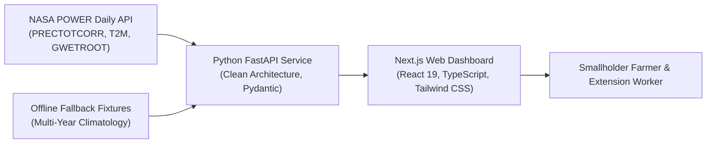

# Rasheed FieldShift

> **“Your data. Your land. Smarter farming decisions.”**

A crop-rotation decision-support tool for smallholder rain-fed farmers in Azare, Bauchi State, Nigeria, built on NASA POWER agro-climatology data.

Developed for the **NASA Space Apps Challenge 2026 (Azare Local Event)** under the challenge:  
**“Field Shift: Adapting Farms with NASA Data.”**

---

### Project & Team Information
- **Event**: NASA Space Apps Challenge 2026 — Azare Local Event (Bauchi State, Nigeria)
- **Team Members**:
  - **Abdulrashid Salisu**
  - **Abdurrahman Muhammad**
  - **Avuurash Rasheed**
  - **Avedden Abravasheer**
- **Repository**: [https://github.com/rasheedy12/Rasheed-FieldShift](https://github.com/rasheedy12/Rasheed-FieldShift)
- **Reference Point**: Azare, Katagum LGA, Bauchi State (`11.6765° N, 10.1911° E`)

---

## 1. The Problem and the Tool

Bauchi smallholders farm in one rainy season, roughly June to September, and face dry spells inside it. Growing cereals year after year also drains soil nitrogen and lets *Striga hermonthica* parasitic weed build up. 

**FieldShift** lets a farmer or agricultural extension worker pick a location, soil type, and priority, then compares three three-year rotations against local NASA POWER agro-climate records to maximize resilience, soil fertility, and household food security.

---

## 2. Dashboard Design

The prototype is organized as a single, intuitive scrolling dashboard arranged in the logical sequence of an agronomic consultation:

1. **Set up the field**: Select farming zone, dominant soil texture, and farming priority.
2. **Read the climate**: Ingest NASA POWER daily parameters and observe the seasonal precipitation and root-zone moisture cycle.
3. **Compare rotations**: Review 3-year crop sequences dynamically scored against field conditions.
4. **Project field trajectory**: Inspect 3-year multi-season trends in soil nitrogen and yield stability, along with a 5-axis resilience radar.
5. **Farmer Advisory Plan**: Generate actionable field operational checklists, planting dates, and printable/PDF advice.

### Wireframe Layout

```text
┌────────────────────────────────────────────────────────────────────────┐
│ Header: Rasheed FieldShift | [Farmer Advisory Plan]                    │
├───────────────────┬──────────────────────┬─────────────────────────────┤
│ Location (Preset) │ Soil Type (Dropdown) │ Farmer Priority (Dropdown)  │
├───────────────────┼──────────────────────┼──────────────┬──────────────┤
│ Rainfall KPI      │ Soil Wetness KPI     │ Temp KPI     │ Dry Mos KPI  │
├───────────────────┴──────────────────────┴──────────────┴──────────────┤
│ Climate Chart: Monthly Rain, Root-Zone Soil Wetness & Temperature      │
├───────────────────┬──────────────────────┬─────────────────────────────┤
│ Card A: Baseline  │ Card B: Soil Builder │ Card C: Climate and Cash    │
│ (Continuous Cereal│ (★ Best Priority     │ (Legume-Cereal-Oilseed      │
│  Monocropping)    │    Match)            │  Drought & Cash Buffer)     │
├───────────────────┴──────────────────────┴─────────────────────────────┤
│ Three-Season Projection Chart (Soil Nitrogen / Yield Stability Toggle) │
│ & Multi-Criteria Resilience Radar (5-Axis Spider Chart)                │
└────────────────────────────────────────────────────────────────────────┘
```

### Design Choices
- **Dark field-green palette**: High-contrast dark theme optimized for low-glare visibility on mobile screens under direct sunlight.
- **Offline-Safe Dropdowns**: Validated agro-ecological presets avoid free-text entry errors and guarantee instant calculation even when disconnected.
- **Data Transparency**: Explicit visual indicators displaying whether data originates from live NASA POWER queries or offline-verified baseline fixtures.

---

## 3. Features

| Feature | What It Does |
| :--- | :--- |
| **Location Presets** | Instant presets for Azare (`11.6765° N, 10.1911° E`), Misau fadama belt, Jama’are river basin, or custom coordinates. |
| **Soil & Priority Inputs** | Sandy loam, loamy sand, or fadama clay loam; prioritized by soil nitrogen, drought resilience, or cash income. |
| **Climate Summary** | Four dynamic KPI cards: estimated annual rainfall, peak root-zone soil wetness, mean annual temperature, and dry-spell risk. |
| **Rotation Comparison** | Three distinct rotations scored on nitrogen replenishment, water resilience, and yield stability with a **★ Best Priority Match** indicator. |
| **Three-Season Projection** | Interactive multi-line chart illustrating 3-year cumulative trajectories for soil nitrogen index and yield stability. |
| **Resilience Radar** | 5-axis polygon visualizer balancing Soil Nitrogen, Water Resilience, Yield Stability, Striga/Pest Control, and Market Return. |
| **Farmer Advisory Plan** | Comprehensive operational modal with sowing rules, crop management calendar, and print/PDF export. |
| **Offline Fallback** | Embedded 5-year NASA POWER climatological fixtures (2021–2025) ensuring zero-downtime operation in remote farm fields. |

---

## 4. NASA Data Integration

FieldShift draws directly on the **NASA POWER Agro-Climatology Daily API** (Community `AG`):

| Parameter | Meaning | Use in FieldShift |
| :--- | :--- | :--- |
| `PRECTOTCORR` | Corrected precipitation, mm per day | Annual rainfall volume, rainy-season share (86% Jun–Sep), and monthly chart bars. |
| `GWETROOT` | Root-zone soil wetness fraction (0.0–1.0) | Evaluates root moisture stress, dry-month persistence, and calculates crop moisture bonuses. |
| `T2M` | Air temperature at 2 m altitude, °C | Tracks mean heat, heatwave risk during April–May pre-season land preparation. |

### Baseline Climatology for Azare
- **Mean Annual Rainfall**: ~790 mm baseline, with unimodal monsoon concentrated strictly between June and September.
- **Root-Zone Soil Wetness**: Drops below 0.28 for 7 consecutive dry-season months (October to May), confirming that continuous monoculture leads to desertification and severe crop failure without rotation.

### Data Honesty & Provenance
1. **Spatial Scale**: NASA POWER gridded data covers approximately $0.5^\circ \times 0.625^\circ$ (~50 km). It reflects regional agro-climatological bounds rather than single-furrow variation.
2. **Modelled Wetness**: `GWETROOT` is an assimilated GMAO MERRA-2 land-surface model product, not an in-situ capacitance probe measurement.
3. **Missing Value Integrity**: Strict handling of NASA fill values (`-999.0`) with honest fallback rather than silent replacement.

---

## 5. Crop-Rotation Comparison Engine

Default baseline view: **Azare, Sandy Loam Soil, Priority: Maximize Soil Nitrogen**. Scores are normalized out of 100.

| Rotation | Sequence (Year 1 → Year 2 → Year 3) | Soil Nitrogen | Water Resilience | Yield Stability | Overall Fit |
| :--- | :--- | :---: | :---: | :---: | :---: |
| **Strategy A: Continuous Cereal (Baseline)** | Pearl Millet → Pearl Millet → Pearl Millet | 31 | 48 | 41 | **37%** |
| **Strategy B: Soil Builder (★ Best Priority Match)** | Pearl Millet → Cowpea (Beans) → Sorghum | 86 | 78 | 83 | **86%** |
| **Strategy C: Climate & Cash** | Groundnut → Sorghum → Sesame (Ridi) | 77 | 86 | 87 | **81%** |

### How Scores are Built
1. **Base Agronomic Score**: Derived from legume nitrogen fixation rates, crop water-use efficiency, and Striga weed suppression.
2. **Soil Texture Modifier**: Sandy loam penalizes nutrient retention; fadama clay boosts late-season water holding.
3. **NASA Moisture Bonus**: Calculated from peak-season `GWETROOT` averages during critical flowering/pod-filling stages.
4. **Farmer Priority Weighting**:
   - **Soil Nitrogen Priority**: Nitrogen (55%), Water Resilience (25%), Yield Stability (20%).
   - **Drought Resilience Priority**: Water Resilience (55%), Yield Stability (30%), Nitrogen (15%).
   - **Cash Income Priority**: Yield Stability (45%), Market Value (35%), Ecological Buffer (20%).

---

## 6. Technical Architecture



| Layer | Technology | Role |
| :--- | :--- | :--- |
| **Frontend** | Next.js 16 (React 19, TypeScript, Tailwind CSS) | Scrolling dashboard, dual-axis SVG visualizer, trajectory simulator, resilience radar, and advisory modal. |
| **Backend** | Python FastAPI (`uvicorn`, `requests`, `numpy`) | Ingests NASA POWER API, validates fill values, computes monthly climatologies, and serves REST endpoints. |
| **Data Pipeline** | NASA POWER Agroclimatology (`AG` community) | Daily rainfall, temperature, and root-zone soil wetness. |
| **Planned Extensions** | Modular hooks for NASA SMAP & GPM IMERG | High-resolution satellite radar soil moisture and precipitation monitoring. |

---

## 7. Known Limitations & Next Steps

### Known Limitations
- **Model-Based Wetness**: `GWETROOT` is a top-level MERRA-2 assimilation model estimate, not a ground soil test.
- **Regional Grid Resolution**: NASA POWER gridded cells (~50 km) represent regional agro-climatic conditions rather than individual parcel microclimates.
- **Scope**: Focused on primary rain-fed dryland crops of the Sudan Savanna (Millet, Sorghum, Cowpea, Groundnut, Sesame).

### Roadmap
1. **Localized Ground-Truth**: Calibrate scoring matrices with field trial data from Bauchi State Agricultural Development Programme (BSADP).
2. **Hausa Language Localization**: Provide full bilingual English/Hausa interface for direct farmer accessibility.
3. **Low-Bandwidth Formats**: Automated generation of compressed SMS/WhatsApp field advisory cards.
4. **Community Field Trials**: Pilot deployments with farmer cooperatives across Katagum, Misau, and Jama'are LGAs.

---

## 8. Quickstart Guide

### Prerequisites
- Node.js 18+ and npm
- Python 3.10+ (tested with Python 3.14)

### 1. Backend Service
```bash
cd backend
python3 -m venv .venv
source .venv/bin/activate
pip install -r requirements.txt
python -m uvicorn app.main:app --host 0.0.0.0 --port 8000
```
Verify backend health:
```bash
curl http://localhost:8000/health
```

### 2. Frontend Web Application
```bash
cd frontend
npm install
npm run dev -- -p 3002
```
Open [http://localhost:3002](http://localhost:3002) in your browser.

### 3. Automated Test Suite
Run backend scientific test suite:
```bash
PYTHONPATH=backend ./backend/.venv/bin/python -m unittest discover -s backend/tests -p "test_*.py" -v
```

---

## License & Space Apps Submission

Developed for the **NASA Space Apps Challenge 2026**.  
Official documentation and technical details are also available in [docs/core_prototype_overview.md](file:///home/rasheedy12/Dev/Rasheed-FieldShift/docs/core_prototype_overview.md) and [docs/space_apps_submission.md](file:///home/rasheedy12/Dev/Rasheed-FieldShift/docs/space_apps_submission.md).
