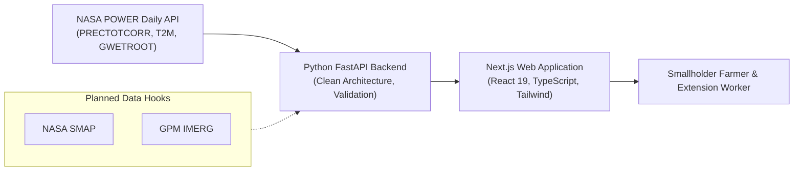

# Rasheed FieldShift: Core Prototype Overview

A crop-rotation decision-support tool for smallholder farmers in Azare, Bauchi State, built on NASA POWER agro-climatology.

**NASA Space Apps Challenge 2026, Azare Local Event**  
**Team**: Abdulrashid Salisu, Abdurrahman Muhammad, Avuurash Rasheed, Avedden Abravasheer  
**Code**: [GitHub Repository](https://github.com/rasheedy12/Rasheed-FieldShift)  

---

## 1. The Problem and the Tool

Bauchi smallholders farm in one rainy season, roughly June to September, and face dry spells inside it. Growing cereals year after year also drains soil nitrogen and lets Striga weed build up. FieldShift lets a farmer or extension worker pick a location, soil type, and priority, then compares three three-year rotations against local climate.

---

## 2. Dashboard Design

The prototype is one scrolling dashboard, arranged in the order a user decides: set up the field, read the climate, compare rotations, see the three-season outlook.

### Wireframe Architecture

```text
┌────────────────────────────────────────────────────────────────────────┐
│ Header: Rasheed FieldShift | [Farmer Advisory Plan]                    │
├───────────────────┬──────────────────────┬─────────────────────────────┤
│ Location (Preset) │ Soil Type (Dropdown) │ Farmer Priority (Dropdown)  │
├───────────────────┼──────────────────────┼──────────────┬──────────────┤
│ Rainfall KPI      │ Soil Wetness KPI     │ Temp KPI     │ Dry Mos KPI  │
├───────────────────┴──────────────────────┴──────────────┴──────────────┤
│ Climate Chart: Monthly Rain, Root-Zone Soil Wetness & Temperature      │
├───────────────────┬──────────────────────┬─────────────────────────────┤
│ Card A: Baseline  │ Card B: Soil Builder │ Card C: Climate and Cash    │
│ (Continuous Cereal│ (★ Best Priority     │ (Legume-Cereal-Oilseed      │
│  Monocropping)    │    Match)            │  Drought & Cash Buffer)     │
├───────────────────┴──────────────────────┴─────────────────────────────┤
│ Three-Season Projection Chart (Soil Nitrogen / Yield Stability Toggle) │
│ & Multi-Criteria Resilience Radar (5-Axis Evaluation)                  │
└────────────────────────────────────────────────────────────────────────┘
```

### Design Choices
- **Dark field-green palette**: Designed with deep contrast, large typography, and plain visual labels for low-bandwidth readability and field use on mobile phones.
- **Controlled inputs**: Dropdowns instead of free text so all agro-ecological presets and calculations remain valid offline without requiring network roundtrips.
- **Direct decision flow**: Arranged sequentially to reflect extension worker consultation steps (Field Profile → Agro-Climate Telemetry → Scenario Evaluation → Tactical Field Plan).

---

## 3. Features

| Feature | What it does |
| :--- | :--- |
| **Location presets** | Azare (`11.6765° N, 10.1911° E`), Misau fadama belt, Jama’are river basin, or custom coordinates. |
| **Soil and priority inputs** | Sandy loam, clay loam, or alluvial soil; priority of soil nitrogen, drought resilience, or cash income. |
| **Climate summary** | Four cards computed from the data: yearly rainfall, peak soil wetness, mean temperature, and dry-soil months. |
| **Rotation comparison** | Three rotations scored on nitrogen, water resilience, and yield stability, with an automated **★ Best Priority Match** badge. |
| **Three-season projection** | Dynamic multi-year trajectory of soil nitrogen or yield stability across Season 1, 2, and 3. |
| **Resilience radar** | 5-axis spider chart comparing Nitrogen, Water Resilience, Yield Stability, Striga/Pest Control, and Market Return. |
| **Farmer plan** | Recommended rotation, seasonal operational calendar, checklist, and print/PDF export drawer. |
| **Offline fallback** | Stored multi-year baseline climatology so the tool works reliably in the field without internet signal. |

---

## 4. NASA Data Integration

FieldShift draws on the **NASA POWER Agro-Climatology Daily API** (Community `AG`) using three core parameters:

| Parameter | Meaning | Use in the tool |
| :--- | :--- | :--- |
| `PRECTOTCORR` | Corrected precipitation, mm per day | Yearly rainfall, rainy-season concentration, and seasonal chart bars. |
| `GWETROOT` | Root-zone soil wetness, 0 to 1 fraction | Moisture bonus in rotation scoring and dry-soil vulnerability metrics. |
| `T2M` | Air temperature at 2 m, in °C | Mean and peak heat index, seasonal temperature cycle line. |

### Azare Baseline Climatology
In the Sudan Savanna baseline of Azare (Katagum LGA, Bauchi State):
- **Annual Rainfall**: ~790 mm baseline, with 86–90% falling strictly between June and September.
- **Root-Zone Wetness**: Remains below 0.28 for 6–7 consecutive dry-season months (October through May), highlighting the necessity of deep-rooting and drought-hardy legumes.

### Data Honesty & Provenance
- **Spatial Resolution**: NASA POWER gridded data is provided at roughly $0.5^\circ \times 0.625^\circ$ (~50 km) resolution. It represents regional agro-climatology rather than single-field micro-topography.
- **Modelled Indicators**: `GWETROOT` is derived from GMAO MERRA-2 assimilation and land-surface modeling, not in-situ capacitance probes.
- **Connectivity & Provenance**: Live retrieval dynamically contacts `power.larc.nasa.gov`. If offline or when remote servers are unreachable, cached local fixtures are used with explicit badge labelling (`offline_fixture`).

---

## 5. Crop-Rotation Comparison

**Default View**: Azare, Sandy Loam Soil, Priority: Maximize Soil Nitrogen. Scores are out of 100.

| Rotation | Years 1 to 3 Sequence | Soil Nitrogen | Water Resilience | Yield Stability | Overall Fit |
| :--- | :--- | :---: | :---: | :---: | :---: |
| **A: Continuous Cereal (Baseline)** | Pearl Millet → Pearl Millet → Pearl Millet | 31 | 48 | 41 | **37%** |
| **B: Soil Builder (Best Match)** | Pearl Millet → Cowpea (Beans) → Sorghum | 86 | 78 | 83 | **86%** |
| **C: Climate & Cash** | Groundnut → Sorghum → Sesame (Ridi) | 77 | 86 | 87 | **81%** |

### How Scores are Built
Each crop rotation has validated agronomic base performance scores:
1. **Soil Texture Adjustment**: The selected soil type (Sandy Loam, Loamy Sand, Fadama Clay Loam) applies drainage and retention factors.
2. **Moisture Bonus**: Derived from peak-season average `GWETROOT` (July–August root-zone saturation).
3. **Priority Weighting**:
   - **Soil Nitrogen Priority**: Weights Nitrogen **55%**, Water Resilience **25%**, and Yield Stability **20%**.
   - **Drought Resilience Priority**: Weights Water Resilience **55%**, Yield Stability **30%**, and Nitrogen **15%**.
   - **Cash Income Priority**: Weights Yield Stability **45%** and Market Return **35%**, with biological buffering **20%**.

---

## 6. Technical Architecture



| Layer | Technology | Role |
| :--- | :--- | :--- |
| **Frontend** | Next.js 16 (React 19, TypeScript, Tailwind CSS) | Interactive scrolling dashboard: field profile inputs, climate telemetry, rotation scoring, trajectory chart, and advisory plan modal. |
| **Backend** | Python 3.14 FastAPI (Pydantic, Requests, NumPy) | Serves `/api/v1/environmental-profile`, handles missing NASA values (`-999.0`), computes climatological statistics, and serves offline fixtures. |
| **Data Pipeline** | NASA POWER Agroclimatology (`AG` community) | Ingests daily precipitation, 2m air temperature, and root-zone soil wetness. |
| **Extensions** | Modular hooks for SMAP and IMERG | Future integration hooks for high-resolution satellite radar soil moisture and precipitation. |

---

## 7. Limitations and Next Steps

### Known Limitations
| Limitation | What it means for users |
| :--- | :--- |
| **Illustrative scoring** | Rotation scores come from a rule-based agro-ecological model, not an empirical multi-decade crop simulation. |
| **Approximate baseline data** | Baseline figures represent regional climatological averages; micro-climates require local calibration. |
| **Coarse spatial scale** | POWER is gridded at ~50 km scale, describing the regional zone rather than field-level soil variance. |
| **Modelled soil wetness** | `GWETROOT` is a MERRA-2 assimilation model fraction, not an on-site volumetric probe reading. |
| **Limited scope** | Currently models core Sudan Savanna crops (Millet, Sorghum, Cowpea, Groundnut, Sesame) under rainfed conditions. |
| **Connectivity** | Live NASA API fetches require internet connectivity; otherwise the offline-safe baseline fixture is displayed. |

### Next Steps & Roadmap
1. **Real Data Ingestion**: Continuously expand offline-safe multi-year fixtures for all 20 Bauchi LGAs (including Misau, Jama'are, Katagum, and Shira).
2. **Local Validation**: Partner with Bauchi State Agricultural Development Programme (BSADP) extension agents and local farmers' cooperatives to calibrate rotation scores against field yield records.
3. **Usability & Accessibility**: Implement full Hausa language localization and one-click SMS/WhatsApp summary cards for feature phones.
4. **Field Pilot**: Deploy prototype trials with farmer groups across Katagum and Jama'are river basins ahead of the 2027 rainy season.

